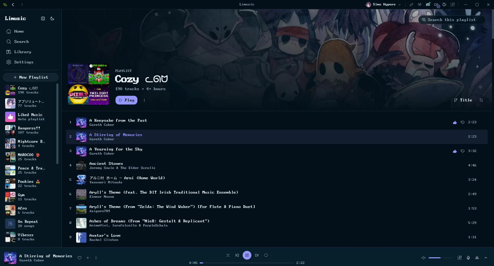
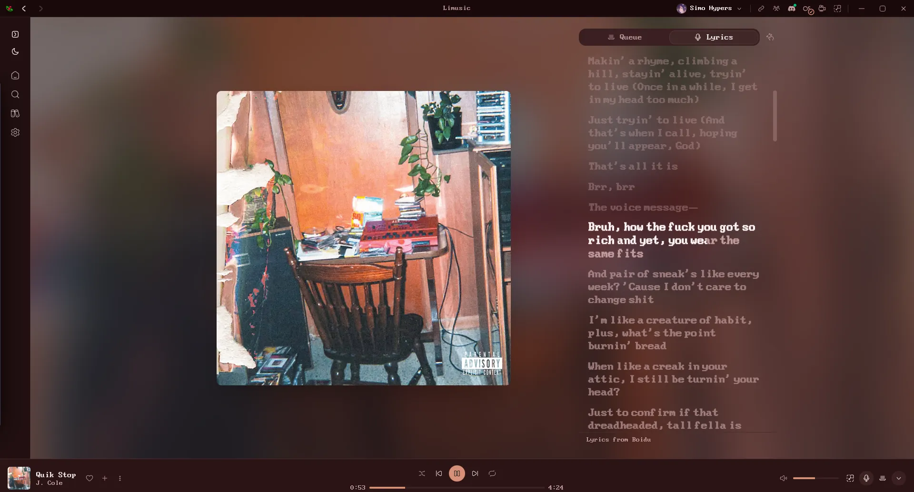
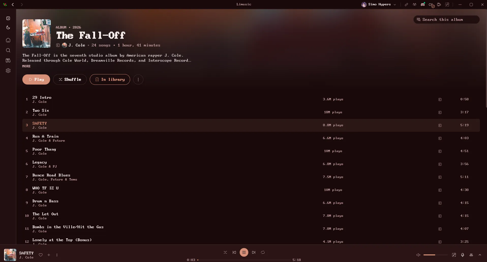
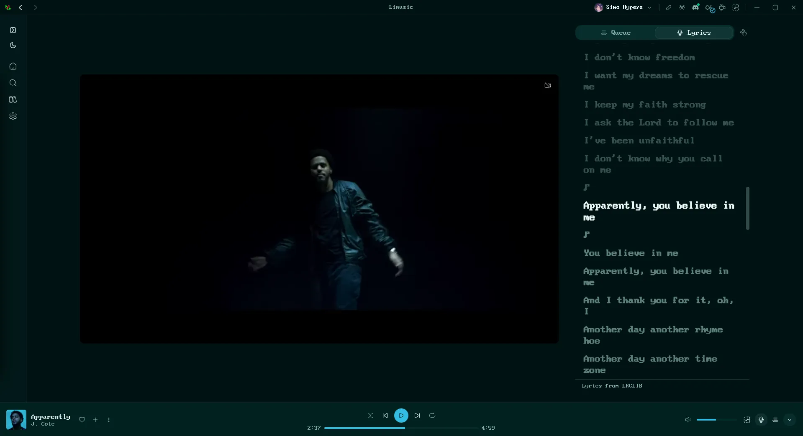

<div align="center">


# Vibratunes

**A native cross-platform YouTube Music client with offline downloads. Rust + Tauri 2, ad-free, no Electron.**

<p align="center">
  
  
  
  <br>
  
  
  
  
</p>

**Vibratunes** talks directly to YouTube's internal API and plays audio through libmpv: no bundled
browser runtime, no backend server, and no ads. Built on top of [Limusic](https://github.com/SimoHypers/limusic) and [Metrolist](https://github.com/mostafaalagamy/Metrolist), Vibratunes enhances the experience with full offline song downloads, an embedded WireGuard/WARP tunnel for bypassing stream throttling, and Android cross-platform support.

</div>

---

## Features

<table>
<tr>
<td width="50%" valign="top">

**Listening & Offline**

- **Offline downloads**: save tracks with full metadata and high-res cover art
- Ad-free playback directly from YouTube's API
- Gapless transitions with loudness normalization
- Radio and automix to keep the queue going
- Music videos, live streams, and podcasts
- Pitch, tempo, and audio effects with equalizer presets
- Local music file playback

</td>
<td width="50%" valign="top">

**Privacy & Connectivity**

- **Embedded WARP tunnel**: toggle a built-in Cloudflare WireGuard proxy from Settings to bypass geo-blocking or network throttling
- Last.fm and ListenBrainz scrobbling
- Discord Rich Presence integration
- Listen Together synchronized rooms with friends
- Multi-device linking and remote session control

</td>
</tr>
<tr>
<td valign="top">

**Lyrics & AI Karaoke**

- Synced word-by-word lyrics with live highlighting
- Duets, romanization, background vocals, and translations
- Multi-source fallback (LRCLIB, Boidu, Kugou, Netease, etc.)
- **AI Karaoke**: real-time vocal separation running on-device (DirectML, Vulkan, CoreML)
- Built-in lyric sync editor

</td>
<td valign="top">

**Your Library**

- Multi-account Google / YouTube sign-in
- Playlists, likes, saved albums, artists, and uploads
- Day-bucketed listening history and on-device listening stats
- Instant search suggestions as you type

</td>
</tr>
<tr>
<td valign="top">

**Desktop & Mobile Experience**

- Mini player, theater mode, and full-screen layouts
- System tray icon with background playback and startup on login
- Global hotkeys, media keys, and native OS notifications
- Touch-friendly UI adaptable to desktop and mobile screens

</td>
<td valign="top">

**Customization**

- Dynamic theme colors extracted from album artwork
- Material You and system palette integration (pywal, wallust, Matugen)
- Custom accent colors, fonts, and application icons
- Multilingual interface supporting over 19 languages

</td>
</tr>
</table>

---

## Screenshots

<table>
  <tr>
    <td></td>
    <td></td>
  </tr>
  <tr>
    <td></td>
    <td></td>
  </tr>
</table>

---

## Build & Install

Vibratunes provides an automated cross-platform build and install script:

### Quick Install (Arch Linux, Fedora, Ubuntu/Debian, macOS, Windows)

```bash
# Clone the repository
git clone https://github.com/2vil/limusic.git vibratunes
cd vibratunes

# Install frontend dependencies
pnpm --dir ui install

# Build release package and install on your system
pnpm build:install:run
```

The script automatically detects your distribution/OS:
- **Arch / Manjaro**: builds a native `.pkg.tar.zst` with desktop entry and installs via `pacman -U`.
- **Fedora / RHEL**: builds and installs an `.rpm` package via `dnf`.
- **Debian / Ubuntu**: builds and installs a `.deb` package via `apt`.
- **macOS**: builds a `.app` bundle and copies it to `/Applications`.
- **Windows**: builds an NSIS setup installer and runs it.
- **Android**: run `pnpm build:install:android` to compile the release APK and install via `adb`.

### Building Manually from Source

**Dependencies (Linux)**:
```bash
# Arch Linux
sudo pacman -S mpv webkit2gtk-4.1 gtk3 base-devel

# Fedora
sudo dnf install mpv-libs mpv-libs-devel webkit2gtk4.1-devel gcc gcc-c++ make openssl-devel librsvg2-devel

# Ubuntu / Debian
sudo apt install libmpv-dev libwebkit2gtk-4.1-dev build-essential libssl-dev librsvg2-dev
```

**Compilation**:
```bash
pnpm --dir ui build
cargo tauri build
```

---

## Scrobbling & Discord

- **Last.fm**: Click the Last.fm badge in the title bar to authenticate. Tracks scrobble at the halfway mark or after 4 minutes.
- **ListenBrainz**: Paste your user token from [listenbrainz.org/settings](https://listenbrainz.org/settings/) under Settings ▸ Scrobbling.
- **Discord**: Toggle Discord Rich Presence to show your current track, artist, album art, and listening progress.

---

## Karaoke

Karaoke uses AI models from [Ultimate Vocal Remover](https://github.com/Anjok07/ultimatevocalremovergui) to separate vocals in real-time completely on your device. No audio is ever sent to external servers.

- Toggle the microphone / karaoke switch under the lyrics view.
- Choose between Light, Balanced, or Best models under **Settings ▸ Playback ▸ Karaoke**.
- Hardware acceleration options:
  - **Windows**: DirectML (GPU)
  - **Linux**: Vulkan (Intel, AMD, NVIDIA)
  - **macOS**: CoreML on Apple Silicon

---

## Credits & Acknowledgements

Vibratunes is a fork of and builds upon the incredible work of:
- [Limusic](https://github.com/SimoHypers/limusic) by **SimoHypers** and contributors.
- [Metrolist](https://github.com/mostafaalagamy/Metrolist) by **Mostafa Alagamy**.
- [Ultimate Vocal Remover](https://github.com/Anjok07/ultimatevocalremovergui) by **Anjok07** & **aufr33**.

---

## Disclaimer

This project is an independent client and is not affiliated with, authorized, maintained, or endorsed by YouTube, Google LLC, or any of their affiliates.

---

## License

[GPL-3.0](LICENSE)
